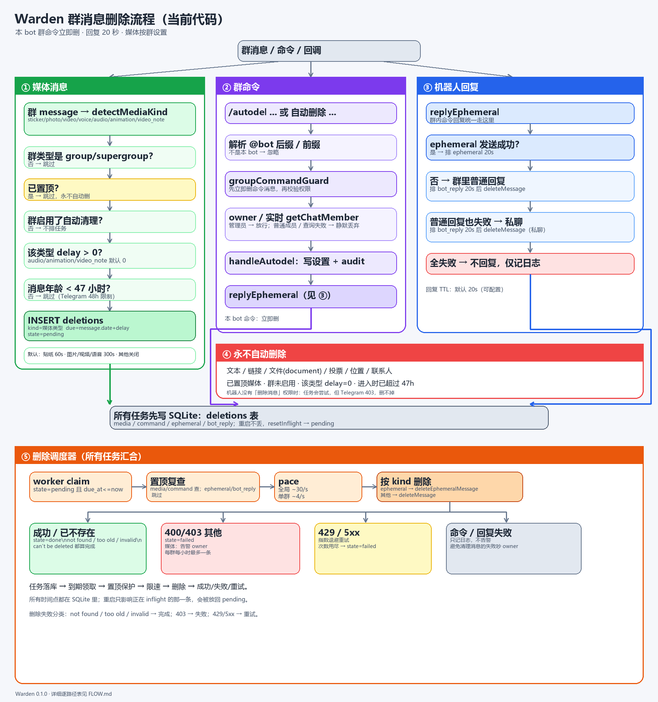
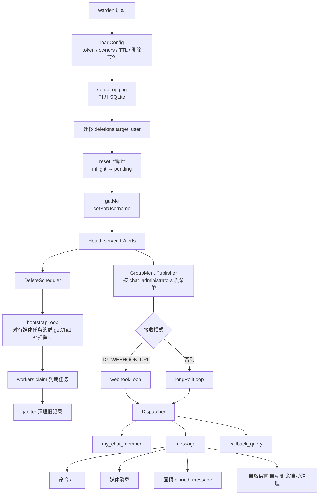
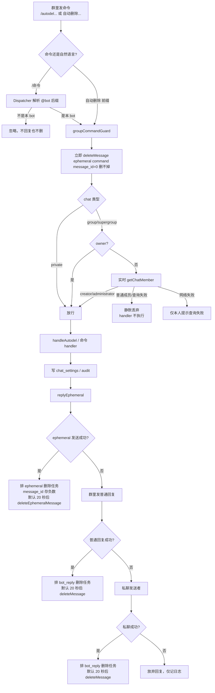
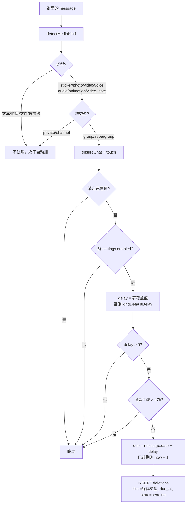
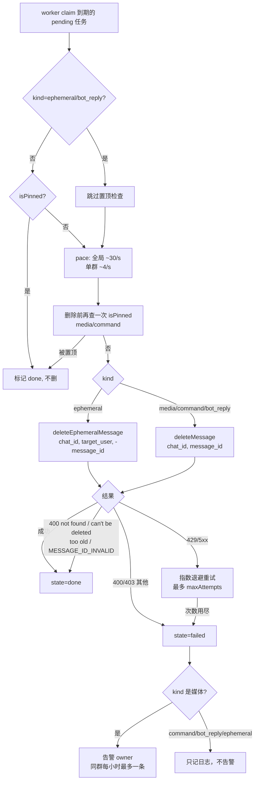

# Warden 全流程图（当前代码）



> 对应代码：`examples/warden`。群里的 `/命令` **立即删除**；自然语言命令本体保留；
> 机器人回复默认 **20 秒**后删（`WARDEN_REPLY_TTL`，0 = 不自动删）。

## 0. 一句话版本

```text
update → 有界队列 → per-chat lane → 固定 worker 协程
媒体消息 → 按类型/群设置排删除任务 → 调度器到期 deleteMessage
群里的 /命令 → 立即删；自然语言命令本体保留；回复优先 ephemeral，失败公开/私聊兜底，20 秒后删
文本/链接/文件 → 完全不动
置顶媒体 → 永不自动删
```

---

## 1. 启动与消息入口



关键点：

- 启动顺序是 **先补扫置顶，再启动删除 worker**，避免重启后逾期任务先删掉置顶消息。
- `resetInflight` 把上次崩溃时卡在 `inflight` 的任务放回 `pending`。
- 任务都在 `deletions` 表里，重启不丢。

---

## 2. 群命令 / 回复 / 命令消息清理



补充：

- 注册命令 + `@本bot`：始终在鉴权前立即删；注册命令没写 `@`：看该行
  `deleteBareCommand`。未注册命令只有明确 `/xxx@本bot` 才删；`/xxx` 和
  `/xxx@OtherBot` 留给其他 bot。
- 用户发的 ephemeral command 对其他成员不可见，但 `message_id=0`，Telegram
  不允许 bot 删除用户侧副本。群里 `/help` 已关闭，只保留私聊 `/help`。
- 自然语言 `自动删除 ...` 是普通文本，**不删命令本体**，只改设置和回复。
- 机器人自己发的 ephemeral **回复**才用 `deleteEphemeralMessage`，不要和用户
  ephemeral command 混为一谈。
- `/autodel` 只改设置和排任务，**不会立刻删历史媒体**。
- `cancel` / `off` 只取消媒体任务；命令与回复的清理任务不会被取消。

---

## 3. 媒体进入与排程



默认时限：

| 类型 | 默认 |
|---|---|
| sticker | 60 秒 |
| photo | 300 秒 |
| video | 300 秒 |
| voice | 300 秒 |
| audio | 关闭 |
| animation | 关闭 |
| video_note | 关闭 |

注意：

- **管理员发的媒体不豁免**，同样按规则删。
- **只保护置顶**；回复了某条消息不会豁免。
- 文本、链接、文件、文档、投票、位置等不在 `detectMediaKind` 里，完全不动。
- 带 caption 的媒体仍按媒体类型处理，caption 随消息一起删。

---

## 4. 删除执行



删除失败的语义：

- 消息已被管理员/用户手动删掉 → 400 not found → 按完成处理，不重试。
- 超过 Telegram 48 小时删除窗口 → `message is too old` → 按完成处理。
- 机器人没有「删除消息」权限 → 403 → 失败；媒体会告警，命令/回复不告警。
- 网络/429/5xx → 退避重试。
- 被置顶 → 直接完成，永不删除。

---

## 5. 删除矩阵（每个路径到底删不删）

| 路径 | 触发 | 删除时间 | 删除方法 | 是否真的删 |
|---|---|---|---|---|
| 注册命令 `@本bot` | 群命令 | **立即** | `deleteMessage` | 始终删 |
| 注册命令裸写 `/autodel` | 群命令 | 看 `deleteBareCommand` | `deleteMessage` | 当前 autodel/status=true |
| 未注册 `/xxx@本bot` | 群命令 | **立即** | `deleteMessage` | 明确 @ 本 bot 才删 |
| `/xxx`、`/xxx@OtherBot` | 群命令 | — | — | 不处理，留给其他 bot |
| 用户发的 ephemeral command | 群命令 | — | — | `message_id=0`，bot 删不掉 |
| 自然语言 `自动删除 ...` | 群文本（普通消息） | — | — | **不删命令本体**，只处理设置/回复 |
| ephemeral 回复 | 群命令回复 | 默认 20s，`WARDEN_REPLY_TTL` | `deleteEphemeralMessage` | 成功发送 ephemeral 才走这条 |
| 群内普通回复兜底 | ephemeral 失败 | 默认 20s | `deleteMessage` | 机器人有删除权限才删 |
| 私聊兜底回复 | 群内普通也失败 | 默认 20s | `deleteMessage` | 私聊消息，通常可删 |
| sticker | 群媒体 | 默认 60s | `deleteMessage` | 群启用且 delay>0 |
| photo | 群媒体 | 默认 300s | `deleteMessage` | 群启用且 delay>0 |
| video | 群媒体 | 默认 300s | `deleteMessage` | 群启用且 delay>0 |
| voice | 群媒体 | 默认 300s | `deleteMessage` | 群启用且 delay>0 |
| audio | 群媒体 | 默认关闭 | `deleteMessage` | 只有显式开启才删 |
| animation | 群媒体 | 默认关闭 | `deleteMessage` | 只有显式开启才删 |
| video_note | 群媒体 | 默认关闭 | `deleteMessage` | 只有显式开启才删 |
| 文本 / 链接 | 任意 | — | — | **永不自动删** |
| 文件 / document | 任意 | — | — | **永不自动删** |
| 投票 / 位置 / 联系人 | 任意 | — | — | **永不自动删** |
| 已置顶媒体 | 群媒体 | — | — | **永不自动删** |
| 群关闭自动清理 | 群媒体 | — | — | 不排任务 |
| 类型 delay=0 | 群媒体 | — | — | 不排任务 |
| 进入时已超过 47h | 群媒体 | — | — | 不排任务（Telegram 48h 限制） |
| 机器人被踢/退群 | 媒体任务 | — | — | 媒体任务取消；命令/回复清理任务保留但会失败 |
| `/panel` 私聊消息 | 私聊 | — | — | 不自动删（私聊控制台消息） |

---

## 6. 权限与边界

- 群命令：仅 owner 或本群管理员；非管理员静默丢弃。
- 群命令消息清理：guard 在鉴权前排任务，所以非管理员的命令消息也会被清理。
- 面板 `/panel`：私聊；owner 看全部群；群管理员只看自己管理且机器人在的群；回调实时 `getChatMember`。
- 机器人必须是管理员并勾选「删除消息」，否则：
  - ephemeral 发不出去 → 走群内普通回复；
  - 群内普通回复也删不掉；
  - 媒体删除失败并告警。
- 机器人隐私模式必须关闭，否则普通成员的媒体消息可能根本收不到。

---

## 7. 关键代码位置

- 启动 / 入口 / 命令 / 回复：[main.cpp](main.cpp)
- 媒体识别 / 默认时限 / 解析：[media.hpp](media.hpp)
- 删除调度：[scheduler.cpp](scheduler.cpp)
- SQLite / 任务表 / 状态迁移：[store.cpp](store.cpp)
- 配置默认值 / TTL：[config.hpp](config.hpp)
- 删除错误分类：[delete_result.hpp](delete_result.hpp)
